# TP4-de-Comunicaciones-de-Datos

## 1) Alcance de Redes y Virtualización

### 1.a

Las redes se clasifican según su alcance geográfico en:

- **PAN (Personal Area Network):** cobertura de pocos metros, conecta dispositivos personales de un mismo usuario (Bluetooth, USB, NFC, infrarrojo).
- **LAN (Local Area Network):** cobertura de un edificio u oficina, administrada por una sola organización, alta velocidad y bajo costo (Ethernet, Wi-Fi local).
- **CAN (Campus Area Network):** interconexión de varias LAN dentro de un campus universitario o corporativo, sin salir del predio.
- **MAN (Metropolitan Area Network):** cobertura de una ciudad, interconecta varias LAN/CAN de distintos puntos de la misma.
- **WAN (Wide Area Network):** cobertura de grandes distancias (países, continentes), generalmente usa enlaces de terceros/ISP (Internet es la WAN más grande).

*(Falta completar en la Figura del enunciado el acrónimo que corresponde a cada recuadro con estas clasificaciones)*

### 1.b

Una **VLAN (Virtual Local Area Network)** es una segmentación lógica de una red física, que agrupa dispositivos en un mismo dominio de broadcast independientemente de su ubicación física o del switch al que estén conectados, como si fuera una LAN separada. Esto permite dividir una red físicamente única en varias redes lógicas aisladas entre sí (por ejemplo, separar tráfico de invitados, administración, distintas áreas de una empresa, etc.) sin necesidad de cablear switches distintos para cada una.

Se pueden clasificar según el criterio de asignación de los puertos a la VLAN:

- **Por puerto (Port-based):** la más común, cada puerto del switch se asigna manualmente a una VLAN.
- **Por dirección MAC:** el switch asigna la VLAN según la MAC del dispositivo conectado, sin importar el puerto físico.
- **Por protocolo:** la VLAN se asigna según el protocolo de capa 3 que use el tráfico (IP, IPX, etc.).
- **Por subred/dirección IP:** se agrupa según el rango de IP del dispositivo.
- **Dinámica:** asignada automáticamente mediante un servidor (VMPS) según reglas predefinidas.

Además, según su función suele hablarse de VLAN de datos, VLAN de voz, VLAN nativa (la que no lleva etiqueta en un trunk) y VLAN de administración/management (como la VLAN 99 que configuramos en el punto 2).

### 1.c

El **IEEE 802.1Q** es el estándar que define el *trunking* o etiquetado de VLANs sobre Ethernet. Especifica cómo insertar una etiqueta (tag) de 4 bytes dentro de la trama Ethernet, ubicada entre la dirección MAC origen y el campo EtherType/Length original. Esta etiqueta contiene:

- **TPID (Tag Protocol Identifier):** 2 bytes, valor fijo 0x8100 que indica que la trama está etiquetada según 802.1Q.
- **TCI (Tag Control Information):** 2 bytes, que incluyen:
  - **PCP (Priority Code Point):** 3 bits, prioridad de la trama (QoS).
  - **DEI/CFI:** 1 bit, indica si puede descartarse en caso de congestión.
  - **VLAN ID:** 12 bits, identifica la VLAN (0 a 4095, permite hasta 4094 VLANs utilizables).

Gracias a esta etiqueta, un mismo enlace físico (un puerto en modo *trunk*) puede transportar el tráfico de múltiples VLANs simultáneamente, porque cada trama queda marcada con la VLAN a la que pertenece y el switch del otro extremo sabe a qué dominio de broadcast reenviarla.

### 1.d

El **Tagging** es el proceso de agregar (o leer) la etiqueta 802.1Q en una trama Ethernet para identificar a qué VLAN pertenece cuando circula por un enlace troncal (trunk) compartido por varias VLANs. Las tramas etiquetadas se llaman *tagged*, mientras que las que no llevan la marca (como las que entran/salen por un puerto en modo *access*) se llaman *untagged*, y el switch las asocia automáticamente a la VLAN configurada en ese puerto (o a la VLAN nativa, en el caso de un trunk). En definitiva, el tagging es el mecanismo concreto por el cual funciona 802.1Q: sin él, un trunk no podría distinguir a qué VLAN pertenece cada trama que transporta.

### 2.i

La VLAN 1, llamada default. Es la VLAN a la que pertenecen automáticamente todos los puertos de un switch Cisco recién configurado, hasta que se les asigna explícitamente otra VLAN. Por eso vemos que todos los puertos (activos e inactivos) siguen listados bajo la VLAN 1, incluso los que después vamos a mover a las VLANs 10, 20 o 99.


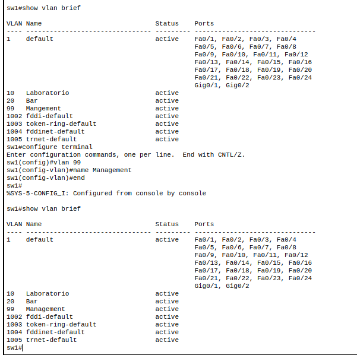


### 2.l

**show ip interface brief (sw1):**

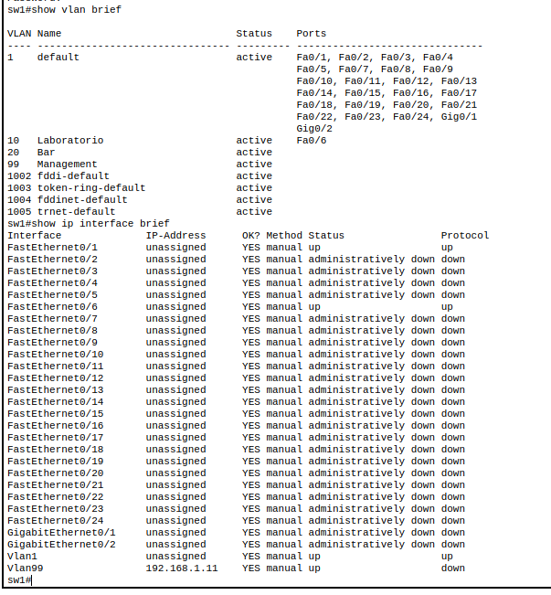

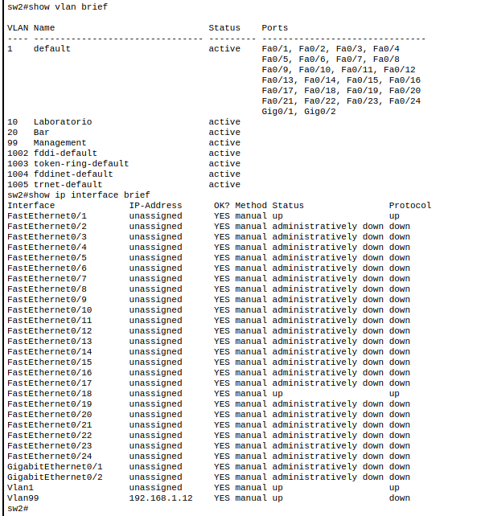


La interfaz Vlan1 quedó sin dirección IP asignada (unassigned) tras el comando `no ip address`, 
aunque se mantiene en estado up/up porque sigue siendo la VLAN nativa del switch. 
La interfaz Vlan99 muestra el estado **up/down**: el "up" indica que la interfaz está 
administrativamente habilitada (no shutdown), pero el "down" del protocolo de línea indica 
que aún no hay ningún puerto físico activo perteneciente a la VLAN 99.


### 2.n


**Ping PC-A a PC-B (192.168.10.4):**

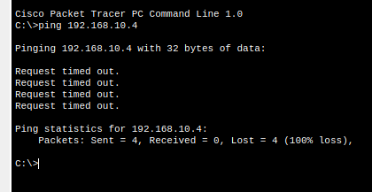


**Ping sw1 a sw2 (192.168.1.12):**

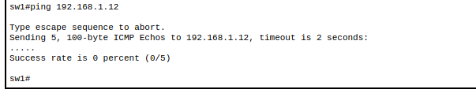


Los dos pings fallan por la misma razón. Cuando movimos los puertos F0/6 y F0/18 a la VLAN 10, 
y las IPs de gestión a la VLAN 99, ese tráfico quedó encerrado dentro de cada switch por 
separado. El cable que conecta sw1 con sw2 (puerto F0/1 en los dos) sigue siendo un puerto 
de acceso normal en la VLAN 1, nunca lo configuramos para que sea un enlace troncal (trunk).

Un puerto de acceso solo deja pasar el tráfico de una sola VLAN. Entonces, aunque PC-A y PC-B 
estén las dos en la VLAN 10, o las direcciones de management de ambos switches estén en la 
VLAN 99, ese tráfico no tiene por dónde cruzar de un switch al otro: el único cable que los 
une solo transporta la VLAN 1.

Esto muestra en la práctica para qué sirve el protocolo 802.1Q que vimos en el punto 1c, para 
que un solo cable entre switches pueda llevar el tráfico de varias VLANs a la vez, hace falta 
configurarlo como trunk, que es lo que permite "etiquetar" cada trama para que el otro switch 
sepa a qué VLAN pertenece.

Como el enunciado no pedía configurar ese enlace como trunk, este resultado (que el ping falle) 
es justamente lo esperado.

## 3) Simulación de red LAN a bordo de una aeronave (VLAN + NAT + ACL)

En este punto se simula el despliegue de una red LAN a bordo de una aeronave comercial. El objetivo es proporcionar conectividad segmentada y con diferentes políticas de acceso según el tipo de usuario y servicio:

- **Clase Turista (VLAN 10):** acceso exclusivo al sistema de entretenimiento local (servidor de a bordo), con el acceso a Internet completamente bloqueado.
- **Clase Business (VLAN 20):** acceso al sistema de entretenimiento local y salida a Internet a través del enlace WAN/ISP satelital mediante NAT.
- **Administración (VLAN 99):** acceso total a todos los recursos de la red (equipos de pasajeros, servidor local y salida a Internet).

---

### 3.a Topología y Diagrama de Red

La topología implementada en Cisco Packet Tracer interconecta los dispositivos finales de cada clase (`PC Turista0`, `PC Turista1`, `PC Business 0`, `PC Business 1`, `PC admin`), el servidor de entretenimiento (`Server0`), un switch capa 2 (`Switch0`) que concentra las conexiones físicas y gestiona las VLANs, un router a bordo (`Router1`) que realiza el enrutamiento inter-VLAN (Router-on-a-Stick), provee DHCP a cada red y aplica las políticas de NAT y ACL, y finalmente un router que simula el proveedor de Internet (`ISP`).

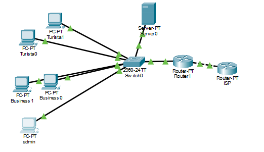

#### Tabla de Direccionamiento y Segmentación

| Segmento / VLAN | Nombre | Red IP | Gateway | Rango Asignado / Host | Acceso Permitido |
| :--- | :--- | :--- | :--- | :--- | :--- |
| **VLAN 10** | Turista | `10.10.10.0/24` | `10.10.10.1` | `10.10.10.11` – `10.10.10.254` (DHCP) | Solo servidor local de entretenimiento |
| **VLAN 20** | Business | `10.10.20.0/24` | `10.10.20.1` | `10.10.20.11` – `10.10.20.254` (DHCP) | Servidor local + Internet |
| **VLAN 99** | Administración | `10.10.99.0/24` | `10.10.99.1` | `10.10.99.11` – `10.10.99.254` (DHCP) | Acceso total a todos los segmentos e Internet |
| **Servidor Local** | Server0 (VLAN 99) | `10.10.99.10/24` | `10.10.99.1` | IP Estática `10.10.99.10` | Servidor HTTP multimedia a bordo |
| **Enlace WAN / ISP**| Punto a Punto | `200.0.0.0/30` | `200.0.0.2` (ISP) | `200.0.0.1` (Router avión) | Salida hacia Internet |

---

### 3.b Configuración del Switch

Para lograr el aislamiento de tráfico a nivel de Capa 2, se definieron tres VLANs en el switch y se asignaron los puertos físicos según el rol de cada dispositivo conectado.

#### 1. Creación de VLANs y Asignación de Puertos de Acceso (`show vlan brief`)

- **Puertos Fa0/2 y Fa0/3:** configurados en modo acceso para la **VLAN 10** (Turista).
- **Puertos Fa0/4 y Fa0/5:** configurados en modo acceso para la **VLAN 20** (Business).
- **Puertos Fa0/6 y Fa0/7:** configurados en modo acceso para la **VLAN 99** (Admin y Server local).

```text
SW(config)# vlan 10
SW(config-vlan)# name Turista
SW(config-vlan)# vlan 20
SW(config-vlan)# name Business
SW(config-vlan)# vlan 99
SW(config-vlan)# name admin
SW(config-vlan)# exit

SW(config)# interface range fa0/2 - 3
SW(config-if-range)# switchport mode access
SW(config-if-range)# switchport access vlan 10

SW(config)# interface range fa0/4 - 5
SW(config-if-range)# switchport mode access
SW(config-if-range)# switchport access vlan 20

SW(config)# interface fa0/6
SW(config-if)# switchport mode access
SW(config-if)# switchport access vlan 99

SW(config)# interface fa0/7
SW(config-if)# switchport mode access
SW(config-if)# switchport access vlan 99
```

En la salida del comando `show vlan brief` se observa la correcta distribución de los puertos de acceso asignados a cada VLAN activa:

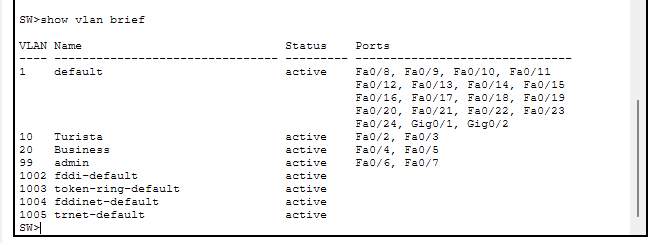

*(Nótese que la interfaz `Fa0/1` no figura en ninguna VLAN de acceso debido a que opera como enlace troncal).*

#### 2. Enlace Troncal hacia el Router (`show interfaces trunk`)

Para que el tráfico de todas las VLANs pueda subir al router mediante un único cable físico (implementando la arquitectura *Router-on-a-Stick*), la interfaz `FastEthernet0/1` fue configurada en modo **trunk** utilizando el protocolo estándar **IEEE 802.1Q**:

```text
SW(config)# interface fa0/1
SW(config-if)# switchport mode trunk
```

En la salida de `show interfaces trunk` se comprueba que el puerto `Fa0/1` se encuentra en estado *trunking*, utilizando la encapsulación `802.1q` con la VLAN nativa 1, y permitiendo el paso de las VLANs `1, 10, 20, 99`:

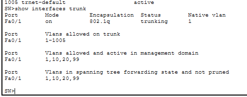

Esta configuración resuelve precisamente la limitación observada en el punto **2.n**, permitiendo que un único enlace físico multiplexe las tramas de los distintos dominios de broadcast mediante el etiquetado (*tagging*) 802.1Q.

---

### 3.c Configuración del Router

El router de la aeronave (`Router1`) centraliza las siguientes funciones críticas:
1. **Router-on-a-Stick (Subinterfaces):** atiende a las VLANs 10, 20 y 99 a través del enlace troncal conectado a su interfaz `Fa0/0`, asignando a cada subinterfaz la IP que funciona como Default Gateway de su respectiva subred.
2. **Servidor DHCP:** asigna direcciones IP dinámicamente a las PCs de cada segmento, excluyendo las primeras 10 direcciones para hosts fijos (gateways y servidor).
3. **NAT con Sobrecarga (PAT):** permite que los clientes autorizados (Clase Business) salgan a Internet traduciendo sus direcciones privadas a la dirección IP pública del enlace WAN (`200.0.0.1`).
4. **Listas de Control de Acceso (ACLs):** bloquea el acceso de la Clase Turista hacia Internet mediante una ACL extendida, preservando al mismo tiempo su acceso al servidor de entretenimiento local.
5. **Ruta por defecto:** dirige el tráfico con destino externo hacia la IP `200.0.0.2` del ISP.

```text
Router(config)# interface fa0/0
Router(config-if)# no shutdown

! Subinterfaces para cada VLAN
Router(config)# interface fa0/0.10
Router(config-subif)# encapsulation dot1Q 10
Router(config-subif)# ip address 10.10.10.1 255.255.255.0
Router(config-subif)# ip nat inside

Router(config)# interface fa0/0.20
Router(config-subif)# encapsulation dot1Q 20
Router(config-subif)# ip address 10.10.20.1 255.255.255.0
Router(config-subif)# ip nat inside

Router(config)# interface fa0/0.99
Router(config-subif)# encapsulation dot1Q 99
Router(config-subif)# ip address 10.10.99.1 255.255.255.0
Router(config-subif)# ip nat inside

! Interfaz WAN hacia ISP
Router(config)# interface fa1/0
Router(config-if)# ip address 200.0.0.1 255.255.255.252
Router(config-if)# ip nat outside
Router(config-if)# no shutdown

! Exclusiones y Pools DHCP
Router(config)# ip dhcp excluded-address 10.10.10.1 10.10.10.10
Router(config)# ip dhcp excluded-address 10.10.20.1 10.10.20.10
Router(config)# ip dhcp excluded-address 10.10.99.1 10.10.99.10

Router(config)# ip dhcp pool Turista
Router(dhcp-config)# network 10.10.10.0 255.255.255.0
Router(dhcp-config)# default-router 10.10.10.1

Router(config)# ip dhcp pool Business
Router(dhcp-config)# network 10.10.20.0 255.255.255.0
Router(dhcp-config)# default-router 10.10.20.1
Router(dhcp-config)# dns-server 8.8.8.8

Router(config)# ip dhcp pool Admin
Router(dhcp-config)# network 10.10.99.0 255.255.255.0
Router(dhcp-config)# default-router 10.10.99.1
Router(dhcp-config)# dns-server 8.8.8.8

! NAT Overload solo para VLAN 20 (Business) mediante ACL estándar 20
Router(config)# access-list 20 permit 10.10.20.0 0.0.0.255
Router(config)# ip nat inside source list 20 interface fa1/0 overload

! Filtro de seguridad: Bloquear acceso a Internet para Turista
Router(config)# access-list 100 deny ip 10.10.10.0 0.0.0.255 any
Router(config)# access-list 100 permit ip any any
Router(config)# interface fa0/0.10
Router(config-subif)# ip access-group 100 out

! Ruta estática por defecto hacia el ISP
Router(config)# ip route 0.0.0.0 0.0.0.0 200.0.0.2
```

En la salida de `show ip route` se comprueba que el router reconoce como directamente conectadas (`C`) las subinterfaces de las tres VLANs (`10.10.10.0/24`, `10.10.20.0/24`, `10.10.99.0/24`), la red de interconexión WAN con el ISP (`200.0.0.0/30`), y la ruta estática por defecto (`S* 0.0.0.0/0`) con *gateway of last resort* en `200.0.0.2`:

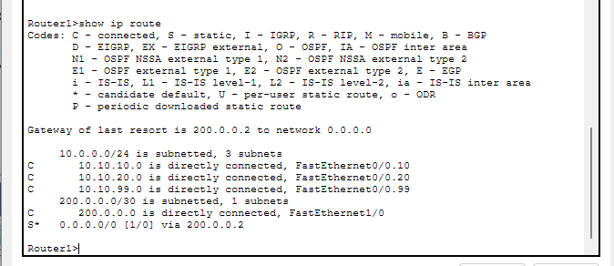

---

### 3.d Servidor de Entretenimiento a Bordo (Servicio HTTP)

En el servidor local (`Server0`, IP estática `10.10.99.10`), perteneciente a la VLAN 99, se configuró y editó el servicio HTTP con una página web personalizada (*"El Fascinante Mundo del Carpincho"*).

Al acceder a la URL `http://10.10.99.10/` desde el navegador web (Web Browser) de un equipo de la red, la página responde de manera instantánea y carga sin inconvenientes. Aunque la captura fue tomada desde la estación de trabajo `admin`, este servicio web local está habilitado y es accesible desde cualquiera de las tres clases (Turista, Business y Admin), cumpliendo la función de portal de entretenimiento a bordo:

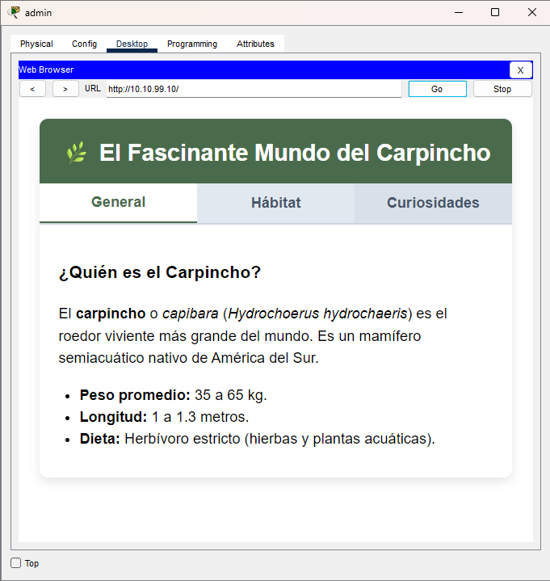

---

### 3.e Pruebas de Conectividad y Verificación

Con la red desplegada y configurada, se ejecutaron las pruebas de conectividad y filtrado especificadas para verificar que se cumplan los requerimientos de acceso de cada clase:

| Desde | Prueba | Hacia | Resultado Esperado | Resultado Obtenido | Estado |
| :--- | :--- | :--- | :--- | :--- | :---: |
| **PC Turista** | Ping al servidor de entretenimiento | `10.10.99.10` | Responde | Responde (`bytes=32 time<1ms TTL=127`) | ✅ Correcto |
| **PC Turista** | Acceso HTTP a servidor local | `http://10.10.99.10` | Carga la página | Carga la página correctamente | ✅ Correcto |
| **PC Turista** | Ping a Internet | `8.8.8.8` | Bloqueado | Bloqueado (`Destination host unreachable`) | ✅ Correcto |
| **PC Business** | Acceso HTTP a servidor local | `http://10.10.99.10` | Carga la página | Carga la página correctamente | ✅ Correcto |
| **PC Business** | Ping a Internet | `8.8.8.8` | Responde | Responde (`bytes=32 time=7ms TTL=254`) | ✅ Correcto |
| **PC Business** | Ping a PC Turista | `10.10.10.12` | Bloqueado | Bloqueado (`Destination host unreachable`) | ✅ Correcto |
| **PC Admin** | Ping a Turista, Business, Servidor y `8.8.8.8` | Todos los destinos | Todos responden | Responden todos los destinos (0% pérdidas) | ✅ Correcto |

#### 1. Verificación desde Clase Turista (`Turista0`)

En la consola de comandos de la estación `Turista0` se verifican dos resultados cruciales:
- **Acceso a entretenimiento permitido:** `ping 10.10.99.10` responde con 0% de pérdidas y tiempos mínimos (`<1ms`). El enrutamiento inter-VLAN permite alcanzar el servidor.
- **Acceso a Internet bloqueado:** `ping 8.8.8.8` es rechazado de inmediato con `Reply from 10.10.10.1: Destination host unreachable` (100% loss). La regla de filtrado en el router bloquea el tráfico saliente de la subred `10.10.10.0/24` hacia Internet, además de no tener permiso de traducción en la lista de NAT.

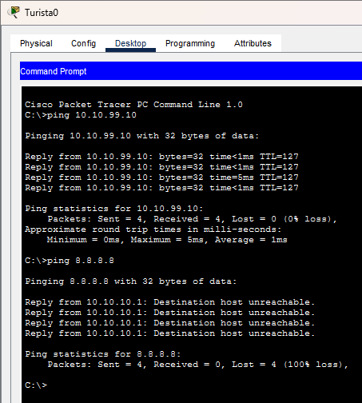

#### 2. Verificación desde Clase Business (`Business0`)

En la estación `Business0`:
- **Salida a Internet habilitada:** `ping 8.8.8.8` responde satisfactoriamente (4 paquetes enviados, 4 recibidos, 0% de pérdida, TTL=254). El router traduce dinámicamente la IP de origen `10.10.20.x` mediante NAT/PAT a la IP pública `200.0.0.1` de la interfaz WAN, enviando el paquete al ISP y devolviendo la respuesta.
- **Aislamiento hacia Turista:** `ping 10.10.10.12` falla con `Reply from 10.10.20.1: Destination host unreachable`, garantizando el aislamiento de red entre las diferentes clases de pasajeros.

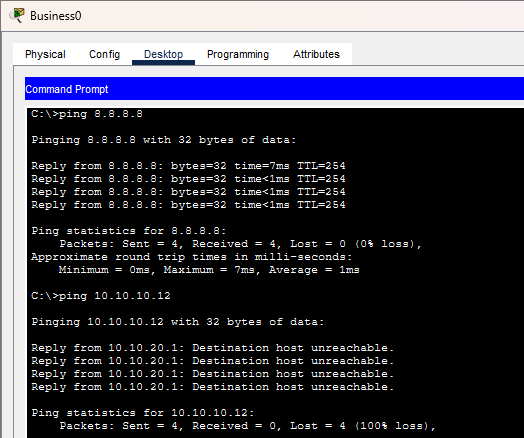

#### 3. Verificación desde Administración (`ADmin`)

La estación `admin` cuenta con privilegios de gestión total:
- `ping 10.10.20.11` a la Clase Business responde con éxito (4/4 recibidos, 0% loss).
- `ping 10.10.99.10` al Servidor de entretenimiento responde con éxito (4/4 recibidos, 0% loss).
- `ping 8.8.8.8` hacia Internet responde con éxito (4/4 recibidos, 0% loss, TTL=254).
- Asimismo, cuenta con conectividad hacia los equipos de la Clase Turista, confirmando el acceso irrestricto necesario para soporte y control del avión.

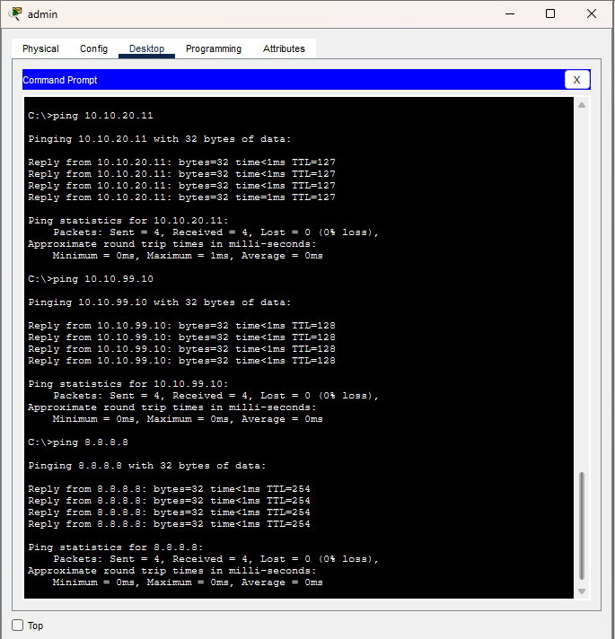

---

### 3.f Conclusiones del Punto 3

### 3.f Conclusiones del Punto 3

La implementación permitió aplicar en un caso concreto los conceptos de segmentación y control de acceso en redes locales. Las VLANs dividieron la red en **dominios de broadcast** independientes (Turista, Business y Admin), y el enlace troncal 802.1Q entre el switch y el router permitió transportar el tráfico etiquetado de las tres VLANs por un único cable. El router, mediante subinterfaces (*Router-on-a-Stick*), resolvió el enrutamiento inter-VLAN, y la combinación de NAT con sobrecarga y ACLs permitió aplicar la política de cada clase: Turista limitado al servidor local, Business con acceso al servidor y a Internet, y Administración con acceso total. Las pruebas de ping y de acceso HTTP verificaron este comportamiento.

Durante el desarrollo surgió una dificultad: una vez armada la topología, el servidor de entretenimiento respondía a los pings, pero el navegador no mostraba la página HTTP. Tras revisar VLANs, troncal, tabla de ruteo y ACLs sin encontrar errores, y comprobar mediante el modo *Simulation* que el pedido HTTP llegaba al servidor y la respuesta volvía, se concluyó que el inconveniente era del propio software. El problema se resolvió **reiniciando Packet Tracer**, tras lo cual la página cargó correctamente desde los equipos de las distintas clases. Esto mostró la utilidad de verificar capa por capa (`show vlan brief`, `show interfaces trunk`, `show ip route`, modo *Simulation*) para distinguir un error de configuración de una falla de la herramienta.

