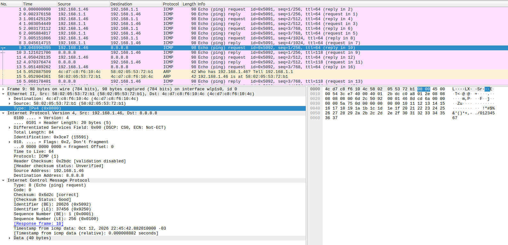
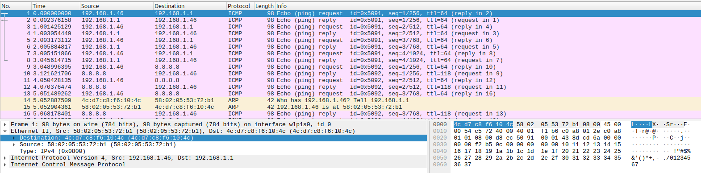
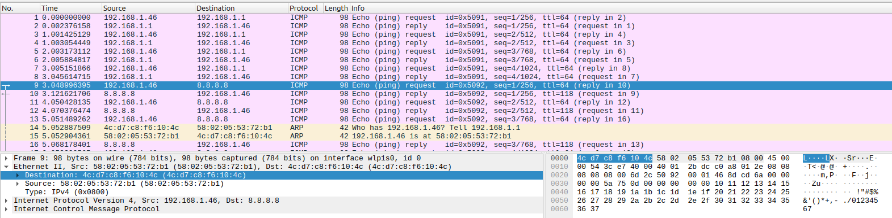
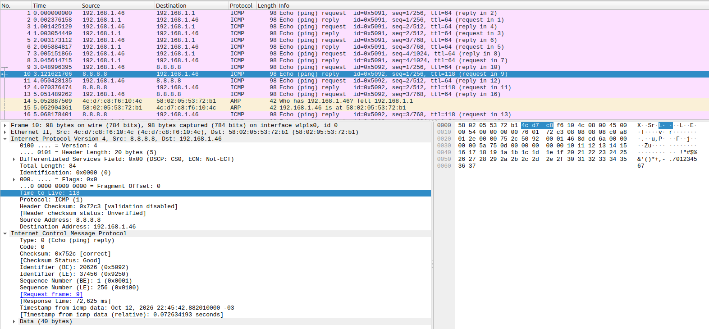
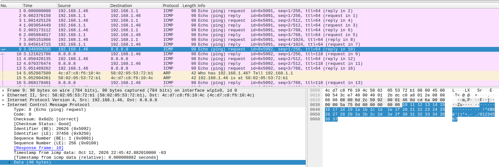
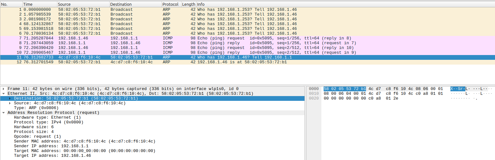
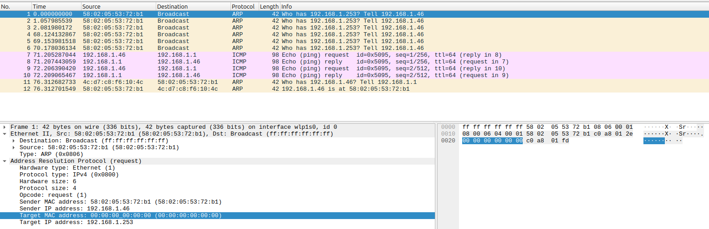
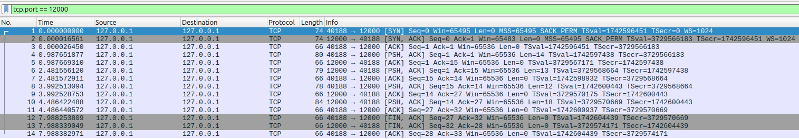
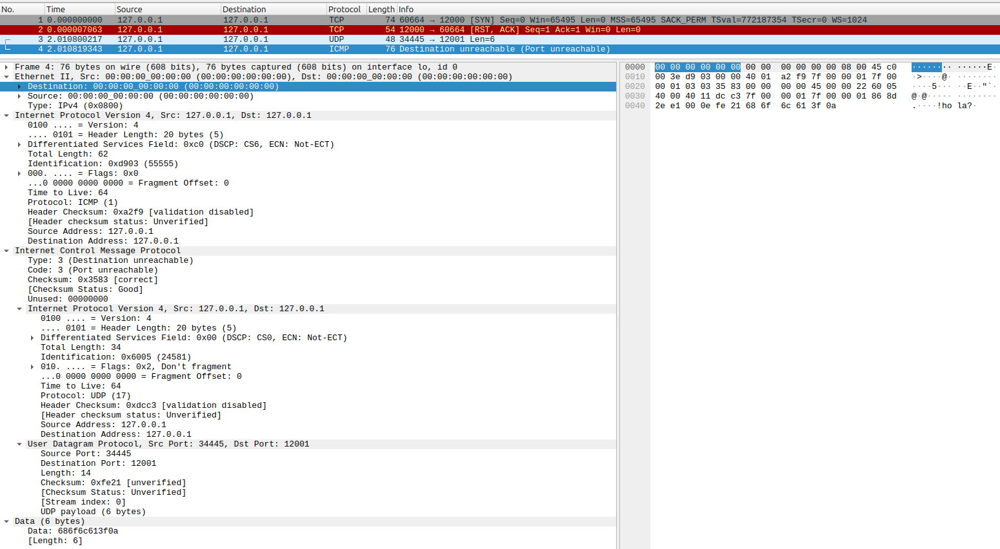
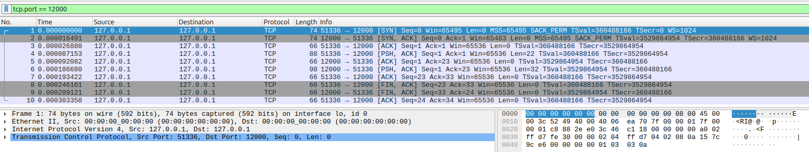

# TP5 - Transmisión de Datos: de ICMP y ARP a Sockets TCP

Las capturas de Wireshark están en `capturas/` y las capturas de pantalla en `capturas/img/`.

## 1) ICMP y primer contacto con Wireshark

### Investigación

**a) ¿Qué es ICMP y para qué se usa?**

ICMP (Internet Control Message Protocol) es un protocolo de la capa de red que se usa para enviar mensajes de control y de error, por ejemplo cuando un destino es inalcanzable o cuando se agota el TTL de un paquete. También se usa para diagnóstico, como hace ping. No transporta datos de aplicaciones como TCP o UDP: no tiene puertos y sus mensajes los maneja el sistema operativo.

**b) ¿Qué relación tiene con IP?**

ICMP viaja dentro de IP: el mensaje ICMP va como datos de un paquete IPv4. El receptor sabe que el contenido es ICMP porque el campo Protocol del encabezado IP vale 1 (para TCP vale 6 y para UDP 17).

**c) ¿Qué hace ping?**

Ping manda mensajes Echo Request a un destino y espera los Echo Reply. Con eso sabe si el destino responde y cuánto tarda la ida y vuelta (RTT). Los dos mensajes se distinguen por el campo Type: 8 es Echo Request y 0 es Echo Reply (en los dos el Code es 0).

**d) ¿Qué información mínima tiene un mensaje ICMP Echo?**

Un encabezado de 8 bytes:

| Campo | Tamaño | Para qué sirve |
|---|---|---|
| Type | 1 byte | 8 = Request, 0 = Reply |
| Code | 1 byte | 0 |
| Checksum | 2 bytes | Control de errores del mensaje |
| Identifier | 2 bytes | Identifica la sesión de ping |
| Sequence number | 2 bytes | Numera cada Echo |

Después del encabezado van los datos, que el Reply devuelve iguales.

### Configuración de red

Usamos `ip addr` y `ip route`:

```
$ ip addr show wlp1s0
2: wlp1s0: <BROADCAST,MULTICAST,UP,LOWER_UP> mtu 1500 qdisc noqueue state UP group default qlen 1000
    link/ether 58:02:05:53:72:b1 brd ff:ff:ff:ff:ff:ff
    inet 192.168.1.46/24 brd 192.168.1.255 scope global dynamic noprefixroute wlp1s0
$ ip route
default via 192.168.1.1 dev wlp1s0 proto dhcp src 192.168.1.46 metric 600
192.168.1.0/24 dev wlp1s0 proto kernel scope link src 192.168.1.46 metric 600
```

| Parámetro | Valor |
|---|---|
| Interfaz | wlp1s0 (Wi-Fi) |
| IPv4 / máscara | 192.168.1.46 / 255.255.255.0 |
| Gateway | 192.168.1.1 |
| MAC | 58:02:05:53:72:b1 |

### Captura de ping

Archivo `capturas/01_icmp.pcapng`. Hicimos `ping -4 -c 4 192.168.1.1` y `ping -4 -c 4 8.8.8.8` y filtramos con `icmp`.

```
$ ping -4 -c 4 192.168.1.1
64 bytes from 192.168.1.1: icmp_seq=1 ttl=64 time=2.39 ms
...
4 packets transmitted, 4 received, 0% packet loss
$ ping -4 -c 4 8.8.8.8
64 bytes from 8.8.8.8: icmp_seq=1 ttl=118 time=72.6 ms
...
4 packets transmitted, 4 received, 0% packet loss
```

Los paquetes 1 a 8 son el ping al gateway y del 9 al 18 el ping a 8.8.8.8 (los paquetes 14 y 15 son ARP, los vemos en el punto 2).

Tabla de capas del Echo Request a 8.8.8.8 (paquete 9):

| Capa | Origen | Destino | Campo que indica qué viene adentro |
|---|---|---|---|
| Ethernet II | 58:02:05:53:72:b1 | 4c:d7:c8:f6:10:4c | Type = 0x0800 (IPv4) |
| Internet Protocol Version 4 | 192.168.1.46 | 8.8.8.8 | Protocol = 1 (ICMP) |
| Internet Control Message Protocol | - | - | No tiene. Type = 8 y Code = 0 indican que es un Echo Request. Identifier = 0x5092, Sequence = 1 |
| Datos / payload | - | - | - (56 bytes) |



Paquete 9 con las capas desplegadas y el campo Type de Ethernet (0x0800) seleccionado.

### Preguntas

**a) ¿La MAC destino del Echo Request a 8.8.8.8 es la de 8.8.8.8?**

No. La MAC destino es 4c:d7:c8:f6:10:4c, que es la del gateway, y es la misma que tiene el ping al gateway. Como 8.8.8.8 no está en nuestra red, la computadora le manda la trama al router, aunque la IP destino siga siendo 8.8.8.8.

La conclusión es que la dirección MAC solo sirve dentro de la red local (cada salto usa una MAC distinta), mientras que la dirección IP identifica al destino final durante todo el camino.



Paquete 1 (ping al gateway): MAC destino 4c:d7:c8:f6:10:4c.



Paquete 9 (ping a 8.8.8.8): la MAC destino es la misma, pero la IP destino es 8.8.8.8.

**b) Echo Request vs Echo Reply (paquetes 9 y 10)**

| Capa | Cambia | Se mantiene |
|---|---|---|
| Ethernet | Se invierten las MAC origen y destino | Type |
| IP | Se invierten las IP; TTL (64 / 118); Identification (0x3ce7 / 0x0000); checksum | Versión, largo del encabezado, Protocol, Total length |
| ICMP | Type (8 / 0); checksum (0x6d2c / 0x752c) | Code, Identifier (0x5092), Sequence (1), datos |

Las direcciones se invierten porque el Reply vuelve al que mandó el Request. El checksum cambia porque cambian otros campos. El identificador y el número de secuencia se mantienen porque así ping sabe a qué Request corresponde cada Reply. Por ejemplo, el ping al gateway usó el identificador 0x5091 y el de 8.8.8.8 el 0x5092.



Paquete 10 (Echo Reply de 8.8.8.8) con el TTL seleccionado. También se ven el Identifier y el Sequence iguales a los del Request.

**c) Payload de ping**

Está después de los 8 bytes del encabezado ICMP y tiene 56 bytes. En Linux los primeros 16 bytes son una marca de tiempo y los 40 restantes son bytes que van aumentando (0x10, 0x11, ..., 0x37). Wireshark los muestra separados como "Timestamp from icmp data" y "Data (40 bytes)". En el Reply el payload es igual.

```
46 8d cd 6a 00 00 00 00  5a 75 0d 00 00 00 00 00   <- marca de tiempo
10 11 12 13 14 15 16 17  18 19 1a 1b 1c 1d 1e 1f   <- bytes que van aumentando
20 21 22 23 24 25 26 27  28 29 2a 2b 2c 2d 2e 2f
30 31 32 33 34 35 36 37
```

En el grupo usamos Linux. Según lo que investigamos, en Windows ping manda 32 bytes con las letras `abcdefghijklmnopqrstuvwabcdefghi`. Que sean distintos indica que el contenido lo decide cada programa de ping y no el protocolo.



Paquete 9 con los datos seleccionados.

**d) TTL**

El Echo Request salió con TTL 64 y el Reply de 8.8.8.8 llegó con TTL 118. No son iguales porque cada sistema empieza con su propio valor de TTL y cada router por el que pasa el paquete le resta 1. Si el servidor empezó con 128, el Reply pasó por unos 10 routers. El Reply del gateway llega con 64 porque no pasa por ningún router.

**e) Encapsulación (paquete 9)**

```
+--------------------------- Trama Ethernet: 98 bytes ---------------------------+
| Encabezado Ethernet | +------------------ Paquete IPv4: 84 bytes ------------+ |
| 14 bytes            | | Encabezado IP | +------- Mensaje ICMP: 64 bytes ---+ | |
|                     | | 20 bytes      | | Encabezado ICMP | Datos          | | |
|                     | |               | | 8 bytes         | 56 bytes       | | |
|                     | |               | +-----------------+----------------+ | |
|                     | +------------------------------------------------------+ |
+--------------------------------------------------------------------------------+
```

14 + 20 + 8 + 56 = 98 bytes.

---

## 2) ARP: de una IP a una dirección MAC

### Investigación

**a) ¿Qué problema resuelve ARP? ¿En qué capa está?**

ARP sirve para averiguar la dirección MAC de un equipo de la red local cuando solo se conoce su IP. Es discutible en qué capa ubicarlo porque trabaja con direcciones IP (capa 3) pero no viaja dentro de IP, sino directamente en una trama Ethernet (capa 2). Por eso a veces se dice que está entre las dos.

**b) ¿Qué es un ARP Request y un ARP Reply?**

El Request es la pregunta "¿quién tiene esta IP?" y se manda en broadcast a todos los equipos de la red, porque todavía no se sabe a quién mandárselo. El Reply es la respuesta del equipo que tiene esa IP, y se manda solo al que preguntó.

**c) ¿Qué es la caché ARP?**

Es una tabla donde el sistema guarda las asociaciones IP-MAC que ya averiguó, durante un tiempo. Existe para no tener que preguntar por ARP antes de cada paquete.

**d) "Tengo la IP de una máquina de mi red local. ¿Cómo sé a qué MAC mandarle la trama?"**

Primero me fijo en la caché ARP. Si la IP está, uso esa MAC. Si no está, mando un ARP Request en broadcast preguntando por esa IP, el equipo que la tiene me contesta con su MAC, la guardo en la caché y recién ahí mando la trama.

**e) Caché ARP**

```
$ ip neigh show
192.168.1.1 dev wlp1s0 lladdr 4c:d7:c8:f6:10:4c REACHABLE
```

La MAC del gateway (4c:d7:c8:f6:10:4c) coincide con la MAC destino que vimos en los pings del punto 1.

**f) Captura de tráfico ARP**

Usamos la opción A: hicimos ping a 192.168.1.253, que no estaba en la caché. Archivo `capturas/02_arp.pcapng`, filtro `arp || icmp`.

```
$ ping -4 -c 2 192.168.1.253
From 192.168.1.46 icmp_seq=1 Destination Host Unreachable
From 192.168.1.46 icmp_seq=2 Destination Host Unreachable
2 packets transmitted, 0 received, +2 errors, 100% packet loss
$ ip neigh show
192.168.1.253 dev wlp1s0 FAILED
192.168.1.1 dev wlp1s0 lladdr 4c:d7:c8:f6:10:4c REACHABLE
```

Qué hay en la captura:

- Paquetes 1 a 3: nuestros ARP Request en broadcast preguntando por 192.168.1.253, sin respuesta.
- Paquetes 4 a 6: lo mismo, al repetir el ping un minuto después.
- Paquetes 7 a 10: ping al gateway, sin ARP antes.
- Paquetes 11 y 12: el router nos manda un ARP Request preguntando por nuestra IP y le respondemos.

Como 192.168.1.253 no existe, nuestros Request no tuvieron respuesta. Para la tabla usamos el Request del router y nuestro Reply (paquetes 11 y 12):

| Campo | ARP Request | ARP Reply |
|---|---|---|
| MAC destino (encabezado Ethernet) | 58:02:05:53:72:b1 | 4c:d7:c8:f6:10:4c |
| MAC origen (encabezado Ethernet) | 4c:d7:c8:f6:10:4c | 58:02:05:53:72:b1 |
| Opcode | 1 (request) | 2 (reply) |
| Sender MAC address | 4c:d7:c8:f6:10:4c | 58:02:05:53:72:b1 |
| Sender IP address | 192.168.1.1 | 192.168.1.46 |
| Target MAC address | 00:00:00:00:00:00 | 4c:d7:c8:f6:10:4c |
| Target IP address | 192.168.1.46 | 192.168.1.1 |



Paquetes 11 y 12.

### Preguntas

**a) ¿Por qué el Request va a broadcast y el Reply no? ¿Qué vale Target MAC en el Request?**

El Request va a broadcast porque el que pregunta no conoce la MAC del destino, que es justamente lo que quiere averiguar. El Reply no, porque el que responde ya sabe la MAC del que preguntó (viene en el Request). La Target MAC del Request vale 00:00:00:00:00:00 porque es el dato que todavía no se conoce.

En nuestra captura el Request del router no fue en broadcast, sino directo a nuestra MAC. Creemos que es porque el router ya tenía nuestra MAC guardada y solo quería confirmar que siguiera siendo válida. Nuestros Request de la opción A sí fueron en broadcast:



Paquete 1: MAC destino ff:ff:ff:ff:ff:ff y Target MAC 00:00:00:00:00:00.

**b) ¿Qué valor tiene el campo Type? ¿Hay encabezado IP?**

El Type vale 0x0806 (ARP). No hay encabezado IP: en Wireshark, debajo de Ethernet II aparece directamente Address Resolution Protocol. Eso muestra que ARP no viaja dentro de IP y solo funciona dentro de la red local.

**c) Opción A: ¿cuántos Request aparecieron? ¿Hubo Reply? ¿Apareció algún Echo Request?**

Aparecieron 3 ARP Request por cada ping, separados por alrededor de 1 segundo, y ningún Reply, porque ningún equipo tiene esa IP. Tampoco apareció ningún ICMP Echo Request: sin la MAC destino la computadora no puede armar la trama, así que el ping nunca sale. El mensaje "Destination Host Unreachable" viene de nuestra propia IP (192.168.1.46), es decir que lo generó nuestra computadora.

**d) ¿Apareció ARP de nuevo un minuto después?**

Para 192.168.1.253 sí, salieron otros 3 Request en broadcast (paquetes 4 a 6), porque la entrada quedó en estado FAILED y no tiene ninguna MAC guardada. Para el gateway no apareció ningún ARP: su entrada siguió en REACHABLE todo el tiempo, porque la usamos constantemente para salir a Internet.

La ventaja de la caché es que no hace falta preguntar por ARP antes de cada paquete, así hay menos tráfico y menos demora. El problema de una entrada vieja es que si el equipo cambia de MAC (por ejemplo, si le asignan esa IP a otro dispositivo), las tramas se siguen mandando a la MAC anterior y no llegan hasta que la entrada se actualice.

---

## 3) TCP y UDP "a mano" con ncat

### Investigación

**a) ¿Qué significa "establecer una conexión"? ¿Dónde existe una conexión TCP?**

Significa que los dos extremos se ponen de acuerdo antes de mandar datos, intercambiando números de secuencia iniciales y otros parámetros con el three-way handshake (SYN, SYN-ACK, ACK). La conexión existe solo en los extremos, como información que guarda el sistema operativo de cada uno. Los cables y routers no saben nada de la conexión: solo reenvían paquetes.

**b) ¿Qué es un puerto? ¿Qué identifica el par (IP, puerto)?**

Un puerto es un número de 16 bits que indica a qué programa de la computadora va dirigido un segmento. El par (IP, puerto) identifica un extremo de la comunicación: una computadora y un programa dentro de ella.

**c) ¿Qué significa que un proceso esté "escuchando" en un puerto?**

Que le pidió al sistema operativo recibir las conexiones (o los datagramas) que lleguen a ese puerto. Si nadie está escuchando, el sistema responde con un RST en TCP o con un ICMP Port Unreachable en UDP.

### Experimento TCP

Archivo `capturas/03_tcp_ncat.pcapng`, capturando en `lo` con el filtro `tcp.port == 12000`. Mandamos 2 mensajes en cada sentido y cerramos el cliente con Ctrl+C.

```
# Terminal A                                 # Terminal B
$ ncat -v -l 12000                           $ ncat -v 127.0.0.1 12000
Ncat: Listening on [::]:12000                Ncat: Connected to 127.0.0.1:12000.
Ncat: Listening on 0.0.0.0:12000             Hola servidor
Ncat: Connection from 127.0.0.1:40188.       Hola cliente
Hola servidor                                Como andas?
Hola cliente                                 Todo bien por aca
Como andas?                                  ^C
Todo bien por aca
```

Se generaron 14 segmentos:

| N° | Sentido | Flags | Qué es |
|---|---|---|---|
| 1 | cliente -> servidor | SYN | Handshake |
| 2 | servidor -> cliente | SYN, ACK | Handshake |
| 3 | cliente -> servidor | ACK | Handshake |
| 4 | cliente -> servidor | PSH, ACK | "Hola servidor" (14 bytes) |
| 5 | servidor -> cliente | ACK | Confirmación |
| 6 | servidor -> cliente | PSH, ACK | "Hola cliente" (13 bytes) |
| 7 | cliente -> servidor | ACK | Confirmación |
| 8 | cliente -> servidor | PSH, ACK | "Como andas?" (12 bytes) |
| 9 | servidor -> cliente | ACK | Confirmación |
| 10 | servidor -> cliente | PSH, ACK | "Todo bien por aca" (18 bytes) |
| 11 | cliente -> servidor | ACK | Confirmación |
| 12 | cliente -> servidor | FIN, ACK | Cierre |
| 13 | servidor -> cliente | FIN, ACK | Cierre |
| 14 | cliente -> servidor | ACK | Cierre |



En la columna Len se ve que solo 4 de los 14 segmentos llevan datos (los mensajes incluyen el salto de línea). En loopback Wireshark muestra las MAC como 00:00:00:00:00:00.

### Experimento UDP

Archivo `capturas/03_udp_ncat.pcapng`, filtro `udp.port == 12001`. Mandamos los mismos mensajes y se generaron 4 datagramas, uno por mensaje:

| N° | Sentido | Contenido |
|---|---|---|
| 1 | cliente -> servidor | "Hola servidor" |
| 2 | servidor -> cliente | "Hola cliente" |
| 3 | cliente -> servidor | "Como andas?" |
| 4 | servidor -> cliente | "Todo bien por aca" |

**a) ¿Qué pasó en la red al ejecutar el cliente, antes del primer mensaje?**

En UDP no pasó nada: el primer paquete de la captura ya es el primer mensaje. ncat igual dice "Connected", pero no se manda nada por la red. En TCP, en cambio, al ejecutar el cliente aparecieron los 3 segmentos del handshake antes de mandar cualquier dato.

**b) ¿Cuántos datagramas generó cada mensaje? ¿Hay algo parecido a un ACK?**

Un datagrama por mensaje. No hay nada parecido a un ACK: UDP no confirma que el mensaje llegó.

**c) Encabezado UDP vs encabezado TCP**

| | UDP | TCP |
|---|---|---|
| Campos | Puerto origen, puerto destino, longitud, checksum | Puerto origen, puerto destino, número de secuencia, número de ACK, longitud del encabezado, flags, ventana, checksum, puntero urgente, opciones |
| Tamaño | 8 bytes | 20 bytes mínimo. En la captura los segmentos con datos tenían 32 bytes y el SYN 40, por las opciones |

**d) ¿Qué pasó al cerrar con Ctrl+C?**

En UDP no se mandó nada, porque no hay conexión que cerrar. En TCP se mandaron 3 segmentos de cierre (12 a 14): FIN del cliente, FIN del servidor junto con el ACK, y el ACK final.

**e) ¿Cuántos paquetes hacen falta para mandar la misma frase? ¿Qué "compran" los paquetes extra de TCP?**

Para mandar solo "Hola servidor", con TCP hacen falta 8 paquetes (3 del handshake, 1 de datos, 1 ACK y 3 de cierre) y con UDP 1. Con los paquetes extra TCP consigue confiabilidad: sabe que el otro extremo existe, confirma lo que llega, puede retransmitir lo que se pierde y entrega los datos en orden. UDP es más liviano, pero no garantiza nada de eso.

**f) ¿Y si nadie escucha?**

Archivo `capturas/03_puertos_cerrados.pcapng`, filtro `tcp.port == 12000 || udp.port == 12001 || icmp`.

```
$ ncat -v 127.0.0.1 12000
Ncat: Connection refused.
$ ncat -v -u 127.0.0.1 12001
Ncat: Connected to 127.0.0.1:12001.
hola?
Ncat: Connection refused.
```

En TCP el cliente manda un SYN (paquete 1) y el sistema responde enseguida con RST, ACK (paquete 2): la conexión se rechaza antes de mandar datos.

En UDP al ejecutar no pasa nada. Cuando escribimos el mensaje sale el datagrama (paquete 3) y el sistema responde con un ICMP Destination Unreachable, Type 3, Code 3, Port unreachable (paquete 4). Adentro del ICMP viene una copia del datagrama que no se pudo entregar.



Paquete 4 desplegado: adentro del ICMP se ven el encabezado IP y UDP del datagrama original y el texto "hola?".

Wireshark muestra el paquete 3 como "LLC" en vez de UDP, porque intenta adivinar el protocolo a partir de los datos. En el ICMP del paquete 4 se ve que en realidad era el datagrama UDP.

**¿Hacía falta usar puertos distintos para TCP y UDP?**

No. Los puertos TCP y UDP son independientes: el sistema primero mira si el paquete es TCP o UDP (campo Protocol de IP) y después el puerto. Usar números distintos solo hace más fácil leer las capturas.

---

## 4) Servidor TCP mínimo

Usamos los scripts de la consigna: `tcp_server.py` y `tcp_client.py`.

### c) Ejecución

Archivo `capturas/04_tcp_scripts.pcapng`, capturando en `lo` con el filtro `tcp.port == 12000`.

```
$ python3 tcp_server.py
[servidor TCP] escuchando en 127.0.0.1:12000 ...
[servidor TCP] conexión aceptada desde 127.0.0.1:51336
[servidor TCP] recibido (22 bytes): 'Hola desde mi programa'
[servidor TCP] respuesta enviada: 'Recibido: Hola desde mi programa'
[servidor TCP] el cliente cerró la conexión

$ python3 tcp_client.py 127.0.0.1 "Hola desde mi programa"
[cliente TCP] conectado a 127.0.0.1:12000 desde 127.0.0.1:51336
[cliente TCP] enviado: 'Hola desde mi programa'
[cliente TCP] respuesta (32 bytes): 'Recibido: Hola desde mi programa'
```

Se generaron 10 segmentos:

| N° | Sentido | Flags | Datos |
|---|---|---|---|
| 1 | cliente -> servidor | SYN | - |
| 2 | servidor -> cliente | SYN, ACK | - |
| 3 | cliente -> servidor | ACK | - |
| 4 | cliente -> servidor | PSH, ACK | "Hola desde mi programa" (22 bytes) |
| 5 | servidor -> cliente | ACK | - |
| 6 | servidor -> cliente | PSH, ACK | "Recibido: Hola desde mi programa" (32 bytes) |
| 7 | cliente -> servidor | ACK | - |
| 8 | cliente -> servidor | FIN, ACK | - |
| 9 | servidor -> cliente | FIN, ACK | - |
| 10 | cliente -> servidor | ACK | - |



Es el mismo patrón que con ncat, pero esta vez toda la conexión duró menos de un milisegundo, porque nadie tuvo que escribir los mensajes a mano.

### d) Llamadas y tráfico

| Llamada | ¿Dónde se ejecuta? | ¿Genera tráfico? | Segmentos que observan |
|---|---|---|---|
| socket() | servidor y cliente | No, solo crea el socket | - |
| bind() | servidor | No, solo asocia la IP y el puerto | - |
| listen() | servidor | No, deja el socket esperando conexiones | - |
| connect() | cliente | Sí, hace el handshake | 1 (SYN), 2 (SYN, ACK), 3 (ACK) |
| accept() | servidor | No, toma la conexión que el sistema ya estableció | - |
| sendall() | servidor | Sí, manda los datos | 6 (PSH, ACK) y su confirmación 7 (ACK) |
| recv() | servidor | No, lee lo que ya llegó. Los datos llegaron en el 4 y el sistema los confirmó con el 5 | - |
| close() | ambos | Sí, cierra la conexión | 8 (FIN, ACK del cliente), 9 (FIN, ACK del servidor), 10 (ACK) |

Solo generan tráfico las llamadas que abren la conexión, mandan datos o la cierran. Las demás son operaciones locales. Algunos segmentos, como el SYN-ACK y los ACK, los manda el sistema operativo por su cuenta, sin que el programa lo pida.

---

## Archivos

- Capturas: `capturas/01_icmp.pcapng`, `02_arp.pcapng`, `03_tcp_ncat.pcapng`, `03_udp_ncat.pcapng`, `03_puertos_cerrados.pcapng`, `04_tcp_scripts.pcapng`
- Capturas de pantalla: `capturas/img/`
- Scripts: `tcp_server.py`, `tcp_client.py`
